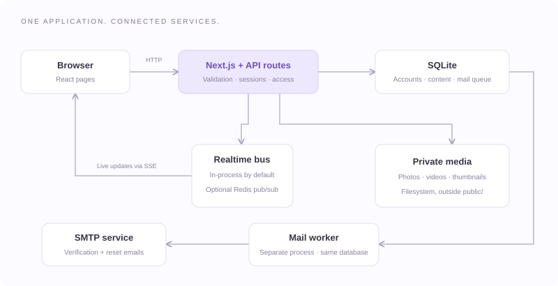

# Architecture

[Documentation index](README.md)

## Runtime stack

| Layer | Implementation |
| --- | --- |
| Web UI | React 18, TypeScript, Tailwind CSS 3 |
| Web server and backend | Next.js 15 App Router and route handlers |
| Validation | Zod schemas plus route-specific checks |
| Database | SQLite using Node's `node:sqlite` `DatabaseSync` |
| Sessions | `jose` JWT access tokens, rotating opaque refresh tokens, HTTP-only cookies |
| Passwords | `bcryptjs` hashes |
| Media | Private local disk; `sharp` for images; optional `ffmpeg`/`ffprobe` for video metadata/posters |
| Email | SQLite outbox and a separate Nodemailer worker |
| Live messaging | Server-Sent Events (SSE); in-process bus by default, optional Redis pub/sub |
| Testing | Vitest and Playwright |

The exact installed dependency versions are pinned by [package-lock.json](https://github.com/pavanxml/loopa/blob/main/package-lock.json). Prisma/PostgreSQL dependencies and reference schemas remain in the repository but do not power the running application.

## Request handling

`src/middleware.ts` rejects API mutations with a mismatched origin or a cross-site fetch marker. Requests without an Origin header must send `X-Loopa-Request: 1`. The middleware also adds API request IDs/cache controls and redirects some unauthenticated page visits based on cookie presence.

Cookie presence is only a navigation hint. Each protected route calls `requireUser()` and checks the signed access token against the live session/user records. Domain checks then enforce ownership, membership, visibility, or moderation permissions. JSON handlers use the shared success/error envelope in `src/lib/api.ts`; media, SSE, and OAuth redirects have different response formats.

The frontend's `apiClient.ts` sends cookies and the mutation header. On an eligible 401 response it coordinates a refresh, retries once, and exposes structured errors to the UI. Web Locks coordinate refresh between tabs where supported.

## Sessions

Access tokens expire after 15 minutes and include a session ID. Refresh cookies expire after 30 days; only a SHA-256 hash of the opaque refresh token is stored. Refresh rotates the session, revokes the old token, and rejects replay by revoking its family. Logout revokes the current family; account suspension and password reset revoke all sessions for that user.

Cookies use `HttpOnly`, `SameSite=Lax`, and `Secure` in production. The current user and role are read from the database when authorizing requests, so changes are not left solely to stale JWT claims.

## Data and privacy

The database module enables foreign keys, WAL journaling, and a 10-second busy timeout. Schema creation and additive upgrades run on import. The shared `transaction()` helper uses synchronous `BEGIN IMMEDIATE` transactions; it rejects callbacks returning promises so locks do not span asynchronous work.

`src/lib/postAccess.ts` centralizes post visibility and related access checks. A visible post must have a published, undeleted record, an active author, permitted account/post audiences, compatible community access, and no block in either direction. Media routes check how an upload is used before serving it. Basic profile avatars can remain visible outside private post access.

## Feed and discovery

The feed first selects up to 300 recent eligible candidates. Following mode keeps chronological order; other modes use deterministic ranking signals such as age, engagement, follows, shared communities, interests, and reports. The ordered IDs are stored in a 15-minute snapshot. Subsequent pages preserve order while checking privacy again.

Post text is indexed in SQLite FTS5. Other discovery surfaces use database queries and visibility filters. Caption/tag assistance and basic text moderation use local heuristics; no external AI service is configured.

## Media lifecycle

1. An authenticated client sends a multipart upload.
2. The server bounds the request, validates content, writes the file, and records upload ownership.
3. Images are re-encoded as JPEG and resized within 4096 × 4096. Thumbnails fit within 480 × 480. Videos retain their uploaded encoding; optional tools extract metadata/posters.
4. The client attaches the returned URL to a post, Spark, profile, or message. Local attachments must belong to the current user.
5. `/api/media/<kind>/<filename>` checks access and serves the file, supporting single byte ranges.

The database stores references and metadata; the media bytes are files. Back up both together. The media service reads each requested file into memory, and thumbnail work runs during upload; these are capacity considerations for a busy deployment.

## Messages and email

Conversation membership and blocks are checked for messages and streams. Streams send `connected`, `message`, `typing`, `read`, and `deleted` payloads, with 25-second keepalive comments. Session/access checks repeat during delivery and heartbeat. SSE is not a durable replay log; reconnecting clients fetch recent history.

The mail worker claims pending rows with a lease, sends through SMTP, and retries up to five attempts. A crash after SMTP acceptance but before recording success may send a duplicate. Sent rows have their body and recipient cleared. Failed/pending rows need operational attention and retention rules.

## Deployment boundary

Run one long-lived Next.js web process on a host with persistent local SQLite/media storage, plus the mail worker. Redis can share rate limits and events but does not make the database or files suitable for multiple application hosts. See [deployment](DEPLOYMENT.md) and [limitations](LIMITATIONS.md).
