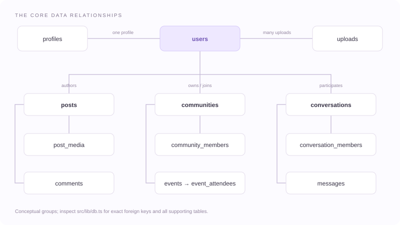

# Database reference

[Documentation index](README.md)

## Source of truth

The runtime schema is [src/lib/db.ts](https://github.com/pavanxml/loopa/blob/main/src/lib/db.ts). It opens SQLite at `SQLITE_PATH`, defaulting to `.data/loopa.db`, creates missing tables/indexes, and applies additive column changes. No external database service is required.

`prisma/schema.prisma` and `docs/schema.postgres.verified.sql` are **legacy PostgreSQL references**. The `db:push`, `db:migrate`, `db:studio`, and generation scripts do not manage this runtime database. Do not run them as part of SQLite setup.

IDs are generally text UUIDs. Booleans are commonly represented as integers. Dates are mostly text, using SQL UTC timestamps or ISO strings; mail retry/lease times are integer milliseconds. Arrays and metadata such as polls, feed IDs, and audit payloads use JSON text.

## Table map

| Area | Tables | Responsibility |
| --- | --- | --- |
| Accounts | `users`, `profiles` | Identity, password hash, role/status, display details, privacy policies |
| Sessions | `refresh_tokens` | Refresh token hashes, session families, expiry, revocation |
| Account recovery | `email_verification_tokens`, `password_reset_tokens` | Hashed single-use tokens, expiry and use timestamps |
| External login | `oauth_accounts` | Provider identity mapped to a local user |
| Social graph | `follows`, `follow_requests`, `connections` | Directed follows, private-account requests, mutual connections |
| Posts | `posts`, `post_media` | Drop body/audience/status/counters/poll JSON and ordered media references |
| Interactions | `comments`, `likes`, `saves`, `hidden_posts` | Replies, likes, saved posts, feed hiding |
| Topics | `hashtags`, `post_hashtags`, `hashtag_follows`, `user_interests` | Tags, tag relationships, followed topics, ranking interests |
| Search | `posts_fts` | FTS5 virtual table for post text; SQLite also creates its internal shadow tables |
| Feed | `feed_snapshots` | Viewer/mode-specific ordered post IDs and expiry |
| Communities | `communities`, `community_members` | Group metadata, owners, member roles/statuses |
| Events | `events`, `event_attendees` | Activities, schedule/location/capacity, attendance |
| Sparks | `moments`, `moment_reactions`, `moment_replies` | Expiring updates, emoji responses, reply records |
| Messaging | `conversations`, `conversation_members`, `messages` | Threads, participants/read state, content and soft deletion |
| Messaging support | `message_reactions`, `presence` | Reaction storage, last-seen and typing data |
| Collections | `collections`, `collection_items` | Named saved-item groups; post assignments also use `saves.collectionId` |
| Notifications | `notifications`, `notification_preferences` | In-app activity records, read timestamps, preference switches |
| Safety | `blocks`, `mutes`, `reports`, `audit_logs` | Relationship restrictions, reports and moderation audit records |
| Uploads | `uploads` | Owner, storage key, URL, type, source upload size, and creation time |
| Email | `mail_outbox` | Queued messages, delivery attempts, leases, and status |

Some tables support unfinished features. A table's presence does not imply a complete UI/API workflow; see [limitations](LIMITATIONS.md).

## Main relationships

This is a conceptual subset, not a declaration that every logical reference has a database foreign key. For example, several polymorphic/legacy references and `posts.communityId` rely on application checks. Inspect `db.ts` before changing relationships.

Unique constraints prevent duplicate usernames/emails and many duplicate relationships, such as a follow pair, one saved post per user, or one membership per community/user. Counters such as post likes/comments and event attendance are stored alongside the related rows; relevant mutations update them together where implemented.

## Persistence and deletion

SQLite runs in WAL mode. A live database can have `loopa.db-wal` and `loopa.db-shm` companion files. Copying only the `.db` file while writes continue can miss committed changes.

Posts, comments, messages, and accounts use status or deletion markers in several flows. Account deletion anonymizes identity rather than deleting every related row. Expired Sparks are pruned when the Sparks list is read; revoked tokens can remain in storage. Removing a record does not necessarily remove its media file. Plan retention and media cleanup separately.

Use [the backup guide](DEPLOYMENT.md#backup-and-restore) for a consistent database/media copy. Keep database backups private: they contain account hashes, messages, and pending recovery links in the mail outbox.

## Evolving the schema

1. Back up an existing database before deploying a change.
2. Add compatible schema changes in `src/lib/db.ts`; use `PRAGMA table_info` to check columns or handle only the expected duplicate-column error.
3. Update validation, access checks, route handlers, and corresponding docs together.
4. Verify with an isolated database and a restored copy of older data.
5. Keep writes inside `transaction()` synchronous; perform asynchronous preparation before entering it.

There is no versioned SQLite migration CLI or automatic downgrade. Changing the legacy Prisma schema does not update runtime tables, and rolling back code alone may not roll back data changes.
